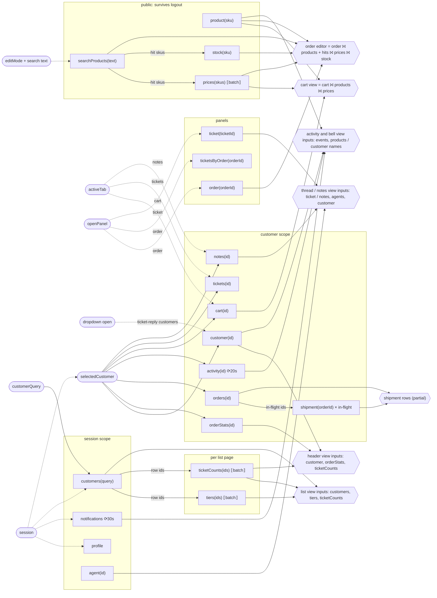
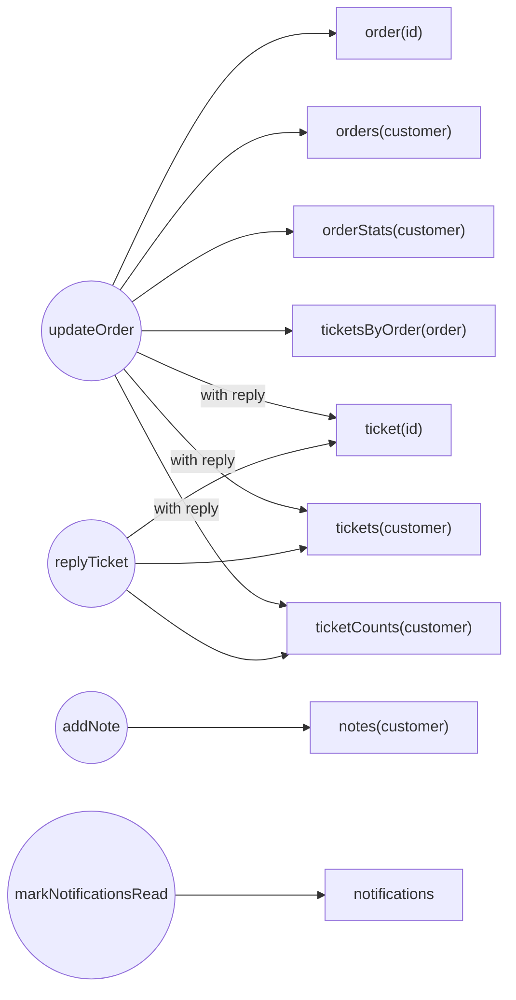

# Dataflow of the test oracle (evaluator only)

The full page (stage 3) as sources, inputs and derived views, independent of
any tool. **Never give this file to an implementer**: it shows requirements
of later stages and one way to structure them. It is here to review
implementations and to explain the measurements.

Requirement ids refer to the stage files.

The backend is split into services that return **ids, not names**
(`spec.md` §2.1): there is no call that joins a customer with its tier, an
order with its tickets or a line with its product name. The page joins them,
so every view below is a join of sources.

Library-agnostic: boxes are sources (one request per key, or per batch of at
most 20 ids), rounded boxes are inputs, hexagons are derived views. Dashed
edges are gates (the source exists only while the gate is open).

Writes and what they invalidate (only what is shown is refetched, R-W):

What the draft exposes per implementation (the interesting parts to compare):

- **Gates:** session → everything user-scope; tab → `cart`/`tickets`/`notes`;
  panel → `order`/`ticketsByOrder`/`ticket`; edit mode with a typed text →
  `searchProducts`; dropdown open → the customer look-ups of notification
  sentences (R-L11).
- **Several sources per view:** a view takes one input per source (its own
  data, and a field component per other-service value), and the sources answer
  at different times. The view does the join by id and shows an empty space
  for a key that has not arrived; the view models carry data only. A failed
  source leaves its empty spaces, not the section broken (R-G6).
- **Batching and sharing:** `tiers`, `ticketCounts` and `prices` take at most
  20 ids per call (`product`, `stock` and `agent` one id); ids asked by
  several sections in the same moment go out once (R-L9, R-L10).
- **Public + user combination:** `cart ⨝ products ⨝ prices` and the order
  editor combine public data with user-scope data. The public side must not
  be requested while the user-scope side is gated off (stage 3, R-L2), and
  must survive logout (R-L6).
- **Fan-out with partial failure:** `orders → shipment × n` (R-P2, R-G3);
  one page of rows → one `tiers` and one `ticketCounts` batch.
- **Parallel instead of chained:** `order` and `ticketsByOrder` both need
  only the order id (R-P3); the linked ticket does not wait for the order.
- **Shared key, several consumers:** `orders` (S5, S9), `notifications`
  (badge, list), `product` (cart, order, activity), `customer` (header,
  notification sentences), `ticketCounts` (row, KPI, badge).
- **Keyed cache:** customers pages, per-customer sources, panels, per-id
  entities (R-L5).
- **Polls with stale-on-error:** `activity`, `notifications` (R-G4).
- **Invalidation after writes**, including a write that outlives its view
  (R-W8, R-W10), and counters owned by other services (`orderStats`,
  `ticketCounts`) that no write response carries.
- **Session switch without stale data** (R-S4) and **customer switch that may
  show the previous data only under a spinner** (R-C2) vs **same-key reload
  with stale data** (R-C3).
