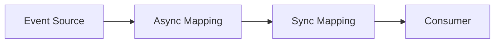

# Reactive patterns

These documents apply the functional, reactive approach from
[Functional programming in Angular](../fp_article.md). They do not retell
that article. Read it first for **why**. This folder is **how the same
pipeline looks on different screens**.

A client card, an edit form, a table, a collapse row, and a virtualized list
look different. The architecture does not. Every flow is still:

That diagram is [chapter 5.2](../fp_article.md). This catalog only changes
the Event Source and the shape of the payload. Which primitive owns which
stage: [rxjs_vs_signals.md](../rxjs_vs_signals.md).

| Stage | Role |
| --- | --- |
| **Event Source** | `entityId`, save click, filters, page, viewport range, expand row |
| **Async Mapping** | HTTP inside a `statefulObservable` `loader`. The only impure boundary |
| **Sync Mapping** | Pure `pipeValue` / `combineStatefulObservables` (`prepareBucket`, create a form). Not `tap` that writes fields |
| **Consumer** | `value$` / `pending$` / `error$` (usually `StatefulBlockComponent`) or the next stream |

The **target** in every scenario is `statefulObservable` (and
`statefulObservableFactory` when the Event Source is a row id). `tiny-store`,
`rxResource`, and raw `switchMap` in this repo are intermediate illustrations
of the same four stages.

Target code: `readonly` declarations, no `.subscribe()` in the component, no
lifecycle hook as a data loader, loading/error on the `statefulObservable`.
Theory: [chapters 3–5](../fp_article.md). Component rules:
[`.opencode/patterns/angular-components.md`](../../.opencode/patterns/angular-components.md).

## Scenarios

| Screen | File | Same pipeline, different Event Source |
| --- | --- | --- |
| Entity card (one API) | [entity-card.md](entity-card.md) | `entityId` |
| Complex entity card | [complex-entity-card.md](complex-entity-card.md) | several entity-card flows + pure combine |
| Entity edit | [entity-edit.md](entity-edit.md) | load pipeline + save pipeline |
| List | [list.md](list.md) | entity-card with an array |
| List with filters and pagination | [list-filters-pagination.md](list-filters-pagination.md) | filters + page |
| List with nested requests | [list-with-nested-requests.md](list-with-nested-requests.md) | list + entity-card per row |
| Virtual scroll | [virtual-scroll.md](virtual-scroll.md) | filters + viewport range |

Demos under `/legacy`, `/optimized`, `/pipe`, `/signals`, `/wip`, and `/x`
are illustrations of these scenarios evolving from dirty to deterministic.
They are not a second catalog.

## Outdated patterns

Name the anti-pattern. Do not write “❌ subscribe” and stop. The **why** lives
in the article; the **what breaks on this screen** lives in each scenario
doc.

| Name | What it looks like | Why (article) |
| --- | --- | --- |
| **Mutating subscription** | `.subscribe()` writes `this.entity`, `this.ready` | [§6.1](../fp_article.md), [§4](../fp_article.md) |
| **Lifecycle orchestration** | `ngOnInit` / `ngOnChanges` as the loader | [§6.2](../fp_article.md), [§6.3](../fp_article.md) |
| **Nested / sequential subscribe** | callback hell; `prepareData` after the last response | [§1](../fp_article.md), [§6.1](../fp_article.md) |
| **Empty form + `patchValue`** | form exists before data | [§6.6](../fp_article.md) |
| **Imperative `load()`** | fields `filters` / `page` / `items`; buttons call a method | [§4](../fp_article.md), [§5.2](../fp_article.md) |
| **Subscribe loop / mutable `detailsById`** | nested fetch inside a list subscribe | [§6.1](../fp_article.md), [§4](../fp_article.md) |
| **Load-all then virtualize** / mutating `scan` | full array in memory; `splice` / `push` in the buffer | [§4](../fp_article.md), [§6.3](../fp_article.md) |

Adoption strategy (how to introduce this on a team) is
[chapter 7](../fp_article.md), not repeated here.
