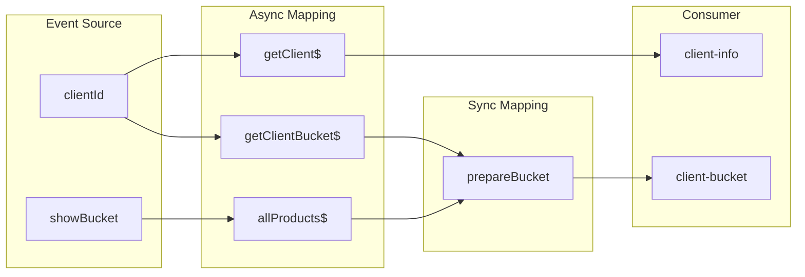

# Complex entity card

A screen assembled from **several** independent HTTP sources (client + bucket
+ products). Each source is an [entity-card](entity-card.md) pipeline.
Complexity is composition in Sync Mapping, not a new architecture.

## Why

[Chapter 5.2–5.3](../fp_article.md): long chains stay safe when each async
edge is a `statefulObservable` and joins happen with
`combineStatefulObservables` (or `combineLatest` of `value$`) plus a pure
function. Implicit time dependencies are [chapter 1](../fp_article.md).

## Same pipeline

Several copies of the same four stages, then one extra Sync Mapping.

| Stage ([§5.2](../fp_article.md)) | This screen |
| --- | --- |
| Event Source | `clientId`; optional `showBucket` for the catalog |
| Async Mapping | three `statefulObservable` loaders, **in parallel**, not nested |
| Sync Mapping | `combineStatefulObservables` + `prepareBucket` / `prepareData` |
| Consumer | two `StatefulBlockComponent`s (`client-info`, `client-bucket`) |

## Canonical dataflow



## Outdated patterns

- **Nested / sequential subscribe** ([§1](../fp_article.md), [§6.1](../fp_article.md)):
  products load only inside the bucket callback; `prepareData` runs after the
  last response.
- **Mutating subscription** on a `forkJoin` ([§6.1](../fp_article.md)):
  sources are parallel, but the consumer is still `this.displayData` /
  `this.ready` ([`combine`](../../src/app/components/optimized/combine/combine.component.ts),
  [`input`](../../src/app/components/optimized/input/input.component.ts)).

```typescript
private fetchBucket() {
  this.bucketApi.getClientBucket$(this.clientId).subscribe((bucket) => {
    this.bucket = bucket;
    this.fetchProducts();
  });
}

private fetchProducts() {
  this.productsApi.allProducts$().subscribe((products) => {
    this.products = products;
    this.displayData = prepareData(this.client, this.bucket, this.products);
    this.ready = true;
  });
}
```

## Problems

- Bucket waits on products even though they do not depend on each other.
- One `ready` flag blocks the whole card if any handle is slow or fails.
- `prepareData(this.client, this.bucket, this.products)` is correct only if
  every subscribe has already fired — a contract in time, not in types.
- Changing `clientId` is not part of the flow (`ngOnInit` once).
- An error on one handle can leave the other fields half-written.

## Target

N times [entity-card](entity-card.md) as `statefulObservable`, then a pure
join. Sources must not block each other.
`pipeValue` / the combine projector stay pure ([§3](../fp_article.md),
[§6.5](../fp_article.md)).

```typescript
public readonly clientId = input.required<number>();

public readonly clientStream = statefulObservable({
  input: toObservable(this.clientId),
  loader: (clientId: number) => this.clientsApi.getClient$(clientId),
  cacheKey: (clientId: number) => [clientId],
});

public readonly bucketStream = statefulObservable({
  input: toObservable(this.clientId),
  loader: (clientId: number) => this.bucketApi.getClientBucket$(clientId),
  cacheKey: (clientId: number) => [clientId],
});

public readonly productsStream = statefulObservable({
  loader: () => this.productsApi.allProducts$(),
  cacheKey: () => ['products'],
});

public readonly populatedBucketStream = combineStatefulObservables(
  [this.bucketStream, this.productsStream],
  ([bucket, products]) => prepareBucket(bucket, products),
);
```

No shared `ready`. Each branch keeps its own `pending$` / `error$`.
`combineStatefulObservables` keeps loading/error on the join;
[`chaos.component.ts`](../../src/app/components/legacy/chaos/chaos.component.ts)
is the same stages with `combineLatest` of `value$` only — treat that join
as one step short of the target.

**Intermediate in this repo:** `displayData$` / `client$` / `tiny-store` /
`rxResource` already exist, but `tap` still writes `ready` or loading
subjects
([`almost-there`](../../src/app/components/pipe/almost-there/almost-there.component.ts),
[`stream`](../../src/app/components/pipe/stream/stream.component.ts),
[`signal`](../../src/app/components/signals/signal/signal.component.ts)).

## In this project

Evolution of **this** scenario, not separate patterns:

| Step | Demo |
| --- | --- |
| Outdated nested subscribe | [`multi-subscribe.component.ts`](../../src/app/components/legacy/multi-subscribe/multi-subscribe.component.ts) |
| Parallel fetch, still mutating | [`combine.component.ts`](../../src/app/components/optimized/combine/combine.component.ts), [`input.component.ts`](../../src/app/components/optimized/input/input.component.ts) |
| Streams + leftover mutation | [`almost-there`](../../src/app/components/pipe/almost-there/almost-there.component.ts), [`stream`](../../src/app/components/pipe/stream/stream.component.ts), [`signal`](../../src/app/components/signals/signal/signal.component.ts) |
| Same stages, other primitives | [`container-rx`](../../src/app/components/wip/container-rx/container-rx.component.ts), [`tiny-store`](../../src/app/components/wip/tiny-store/tiny-store.component.ts), [`resource`](../../src/app/components/wip/resource/resource.component.ts) |
| Target: independent `statefulObservable` + combine | [`chaos.component.ts`](../../src/app/components/legacy/chaos/chaos.component.ts) |

`prepareBucket` / `prepareData` live in
[`src/app/services/utils.ts`](../../src/app/services/utils.ts).

## Composition

Each handle is [entity-card](entity-card.md). A catalog without a parent id
is [list.md](list.md) (`allProducts$`). Do not fold save into this file;
that is [entity-edit.md](entity-edit.md).
