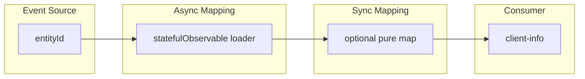

# Entity card (one API)

A screen that depends on **one** HTTP handle. Related bucket/products belong
in [complex-entity-card.md](complex-entity-card.md). Nested fetch on a list
row is the same pipeline as this file; see
[list-with-nested-requests.md](list-with-nested-requests.md).

## Why

This is the smallest instance of the data flow in
[chapter 5.2](../fp_article.md). Reactive inputs and the ban on mutating
subscriptions are [§6.1–6.3](../fp_article.md). Do not retell cognitive load
here; that is [chapter 1](../fp_article.md).

## Same pipeline

The costume changes. The four stages do not.

| Stage ([§5.2](../fp_article.md)) | This screen |
| --- | --- |
| Event Source | `entityId` (`input()`, route param, or parent stream) |
| Async Mapping | `statefulObservable` `loader`: `getClient$(id)` |
| Sync Mapping | optional `pipeValue` (pure `map`) |
| Consumer | `StatefulBlockComponent` + `client-info` (`value$`) |

## Canonical dataflow



## Outdated patterns

- **Mutating subscription** ([§6.1](../fp_article.md), [§4](../fp_article.md)):
  `.subscribe()` writes `this.entity` and `this.ready`.
- **Lifecycle orchestration** ([§6.2](../fp_article.md), [§6.3](../fp_article.md)):
  `ngOnInit` / `ngOnChanges` is the loader; `@Input() entityId!` with a `!`
  assertion.

```typescript
@Input() clientId!: number;
client!: Client;
ready = false;

ngOnInit() {
  this.clientsApi.getClient$(this.clientId).subscribe((client) => {
    this.client = client;
    this.ready = true;
  });
}
```

## Problems

On this screen those patterns fail as follows (theory: the sections above):

- A new `entityId` does not reload unless someone remembers `ngOnChanges`.
- `ready` and `client` are a hidden contract in time; the template can read
  them before they exist.
- No unsubscribe → leak when the card is destroyed mid-request.
- The compiler cannot see Event Source → Consumer as one typed flow.

## Target

Same mermaid. `statefulObservable` is the Async Mapping. Loading/error live
on the stream (`pending$`, `error$`), not on `this.ready`.

```typescript
public readonly clientId = input.required<number>();

public readonly clientStream = statefulObservable({
  input: toObservable(this.clientId),
  loader: (clientId: number) => this.clientsApi.getClient$(clientId),
  cacheKey: (clientId: number) => [clientId],
});
```

Consumer: `<app-stateful-block [stream]="clientStream">` then
`clientStream.value$ | async` into `client-info`.

**Intermediate in this repo:** raw `switchMap` / `tiny-store` / `rxResource`
with the same stages, but loading still via `tap` + writable flags
([`stream.component.ts`](../../src/app/components/pipe/stream/stream.component.ts),
[`signal.component.ts`](../../src/app/components/signals/signal/signal.component.ts)).
That is [§6.5](../fp_article.md): keep `map` / `pipeValue` pure.

## In this project

The client branch of every card demo:

- Target: `clientStream` in
  [`chaos.component.ts`](../../src/app/components/legacy/chaos/chaos.component.ts).
- Same stages, not the final primitive: `client$` in
  [`stream.component.ts`](../../src/app/components/pipe/stream/stream.component.ts),
  `clientStore` in
  [`tiny-store.component.ts`](../../src/app/components/wip/tiny-store/tiny-store.component.ts),
  `clientResource` in
  [`resource.component.ts`](../../src/app/components/wip/resource/resource.component.ts).
- Outdated:
  [`multi-subscribe.component.ts`](../../src/app/components/legacy/multi-subscribe/multi-subscribe.component.ts)
  (`fetchClient` subscribe).

## Composition

- Several of these flows on one screen → [complex-entity-card.md](complex-entity-card.md).
- Load then form → [entity-edit.md](entity-edit.md).
- One flow per list row, lazy → [list-with-nested-requests.md](list-with-nested-requests.md).
