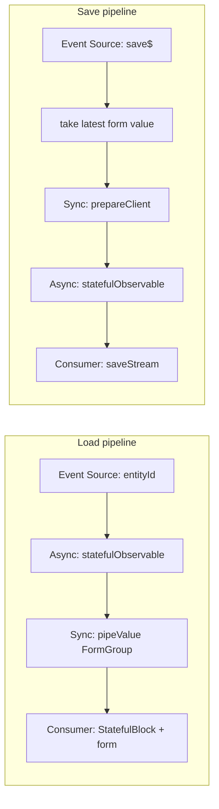

# Entity edit

Load one entity, show a form, save. Two copies of the
[§5.2](../fp_article.md) pipeline: **load** (same as
[entity-card](entity-card.md)) and **save** (submit is a different Event
Source). This is not a special “forms architecture”.

There is **no edit demo route** in the app. The target is
[chapter 6.6](../fp_article.md). Filter forms in the repo already treat a
form as a stream
([`clients-filter-form.component.ts`](../../src/app/components/content/clients-filter-form/clients-filter-form.component.ts)).

Do not grow this into [complex-entity-card.md](complex-entity-card.md) until
the form actually needs several HTTP handles.

## Why

[§6.6](../fp_article.md): a form that cannot exist until async data arrives
must be **created in the stream**, not patched later. Mutating save
subscriptions are [§6.1](../fp_article.md). Hidden mutation breaking a
derived chain is [chapter 4](../fp_article.md).

## Same pipeline

| Stage ([§5.2](../fp_article.md)) | Load | Save |
| --- | --- | --- |
| Event Source | `entityId` | `save$` (submit) |
| Async Mapping | `statefulObservable` → `getEntity$` | `statefulObservable` → `saveClient$` |
| Sync Mapping | `pipeValue` → `FormGroup` from entity | `map` → `prepareClient` from form value |
| Consumer | `StatefulBlock` + form template | `saveStream.value$` |

## Canonical dataflow



## Outdated patterns

- **Empty form + `patchValue`** ([§6.6](../fp_article.md)): construct the
  group in `ngOnInit` with blanks, then patch when HTTP returns.
- **Mutating subscription** on save ([§6.1](../fp_article.md)):
  `save()` reads `this.editForm.value` and `.subscribe()`s the result.

```typescript
editForm: FormGroup;

ngOnInit() {
  this.editForm = this.fb.group({
    name: ['', Validators.required],
    email: ['', [Validators.required, Validators.email]],
  });
  this.clientApi.getClient$(this.clientId).subscribe((client) => {
    this.editForm.patchValue({ name: client.name, email: client.email });
  });
}

save() {
  this.clientApi.save$(this.editForm.value).subscribe(...);
}
```

## Problems

On this screen ([§6.6](../fp_article.md)):

- The user sees empty fields and can type before data exists.
- Validation flags empty required fields as invalid while loading.
- `patchValue` is a mutation that is not in the Event Source → Sync Mapping
  chain ([§4](../fp_article.md)).
- Save can run against a form that never received the entity.
- Loading is not a stage of the flow; it is a missing template branch.

## Target

The form **is** `pipeValue` on a load `statefulObservable`. Save is a second
`statefulObservable` whose Event Source is submit.

```typescript
public readonly clientId = input.required<number>();

public readonly editFormStream = statefulObservable({
  input: toObservable(this.clientId),
  loader: (clientId: number) => this.clientApi.getClient$(clientId),
  cacheKey: (clientId: number) => [clientId],
}).pipeValue(
  map((client) =>
    this.fb.group({
      name: [client.name, Validators.required],
      email: [client.email, [Validators.required, Validators.email]],
    }),
  ),
);

private readonly formValue$ = this.editFormStream.value$.pipe(
  switchMap((form) => getFormValueAndValidity$(form)),
);

private readonly save$ = new Subject<void>();

public readonly saveStream = statefulObservable({
  input: this.save$.pipe(
    switchMap(() => this.formValue$.pipe(take(1))),
    filter(({ valid }) => valid),
    map(({ value }) => prepareClient(value)),
  ),
  loader: (client) => this.clientApi.saveClient$(client),
});
```

The article listing in [§6.6](../fp_article.md) is the same two pipelines
without `statefulObservable`; wrap both async edges as above. Template:
`<app-stateful-block [stream]="editFormStream">` so there is no empty group
to patch. Save loading/error come from `saveStream`, not a subscribe.

## In this project

- Written target: wrap [§6.6](../fp_article.md) in `statefulObservable` (no
  `/edit` route).
- Form-as-stream elsewhere:
  [`clients-filter-form.component.ts`](../../src/app/components/content/clients-filter-form/clients-filter-form.component.ts)
  (`valueChanges` as `@Output`), pagination `FormGroup` created from
  `formValue$` in
  [`pagination.component.ts`](../../src/app/components/xprerimental/pagination/pagination.component.ts).

## Composition

Load is [entity-card](entity-card.md). If the form needs client + bucket,
compose like [complex-entity-card.md](complex-entity-card.md), then `map` to
one `FormGroup`. Do not `patchValue` after a second request.
