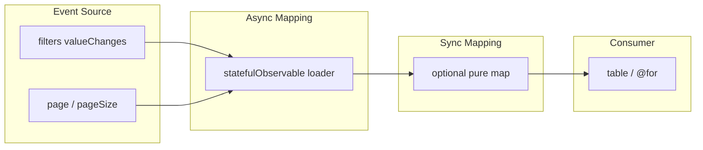

# List with filters and pagination

A table driven by **filters + page**. That pair is the Event Source of the
same [§5.2](../fp_article.md) pipeline as [list.md](list.md). Buttons,
infinite scroll, or a page control only change **how page is produced**,
not the architecture.

Windowed fetch by visible indexes is
[virtual-scroll.md](virtual-scroll.md). Expand-a-row is
[list-with-nested-requests.md](list-with-nested-requests.md).

## Why

Sequences and combinations of sources are [§5.2–5.3](../fp_article.md).
Storing `filters`, `page`, and `items` as fields and calling `load()` is
hidden mutation ([chapter 4](../fp_article.md)) plus a mutating
subscription ([§6.1](../fp_article.md)). Filter forms as streams:
[`clients-filter-form.component.ts`](../../src/app/components/content/clients-filter-form/clients-filter-form.component.ts).

## Same pipeline

| Stage ([§5.2](../fp_article.md)) | This screen |
| --- | --- |
| Event Source | filter `valueChanges` + `page` / `pageSize` |
| Async Mapping | `statefulObservable` `loader`: `searchClientsPaged$` |
| Sync Mapping | optional `pipeValue`; page reset when filters change |
| Consumer | `StatefulBlockComponent` + table / `@for` |

Infinite scroll: Event Source for page is “scrolled to end” → `page + 1`,
same loader. `scan` that appends must return a **new** array
([§4](../fp_article.md)).

## Canonical dataflow



## Outdated patterns

- **Imperative `load()`** ([§4](../fp_article.md), [§6.1](../fp_article.md)):
  component fields hold filters, page, and items; prev/next and filter
  changes call a method that mutates `this.items`.

```typescript
filters = {};
page = 1;
items: Client[] = [];

onFilterChange(filters) {
  this.filters = filters;
  this.page = 1;
  this.load();
}

nextPage() {
  this.page += 1;
  this.load();
}

load() {
  this.api.search$(this.filters, this.page).subscribe((res) => {
    this.items = res.data;
  });
}
```

## Problems

- Filters moved, `page` still points at the previous query.
- Double-click next races two `load()` calls; last write wins.
- Infinite-scroll `items.push(...)` mutates the array the template tracks.
- Loading is a boolean next to the request, not part of the stream.
- You cannot read Event Source → Consumer from the field list.

## Target

Filters and pagination **are** the Event Source. One `statefulObservable`.
Consumer reads `stream.value$` / `pending$` / `error$`.

```typescript
public readonly formValue$ = new Subject<ClientsFilterFormValue>();

public readonly pagination$ = this.formValue$.pipe(
  map(() =>
    this.fb.group({
      page: this.fb.control(1),
      pageSize: this.fb.control(10),
    }),
  ),
  shareReplay(1),
);

public readonly stream = statefulObservable({
  input: combineLatest([this.formValue$, this.paginationValue$]),
  loader: ([filters, { page, pageSize }]) =>
    this.clientApiService.searchClientsPaged$({ ...filters, page, pageSize }),
  cacheKey: ([filters, pagination]) => [filters, pagination],
});
```

Canonical demo:
[`pagination.component.ts`](../../src/app/components/xprerimental/pagination/pagination.component.ts).

**Infinite scroll** keeps this mermaid. Page Event Source is an
IntersectionObserver. Target `scan` copies the accumulator; do not
`acc.data.push`. The demo
[`infinite-scroll.component.ts`](../../src/app/components/xprerimental/infinite-scroll/infinite-scroll.component.ts)
still mutates in `scan` — treat that as intermediate ([§4](../fp_article.md)).

## In this project

- Target-shaped paging:
  [`pagination.component.ts`](../../src/app/components/xprerimental/pagination/pagination.component.ts)
  +
  [`ClientsFilterFormComponent`](../../src/app/components/content/clients-filter-form/clients-filter-form.component.ts).
- Same loader, other page Event Source:
  [`infinite-scroll.component.ts`](../../src/app/components/xprerimental/infinite-scroll/infinite-scroll.component.ts).

## Composition

Without filters/page this is [list.md](list.md). Viewport range instead of
page buttons → [virtual-scroll.md](virtual-scroll.md). Row expand →
[list-with-nested-requests.md](list-with-nested-requests.md).
