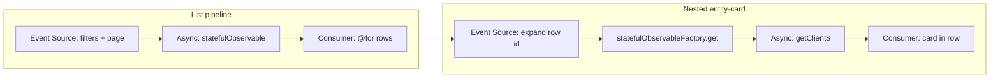

# List with nested requests

A list (often already filtered and paged) plus a **lazy** request per row:
expand, details, child entities. The outer flow is
[list.md](list.md) or
[list-filters-pagination.md](list-filters-pagination.md). The inner flow is
[entity-card.md](entity-card.md) keyed by row id. That is two copies of
[§5.2](../fp_article.md), not a third architecture.

Do not prefetch every nested handle inside the list loader (`forkJoin` over
all ids). If every row needs the extra data up front, that is
[complex-entity-card.md](complex-entity-card.md) per item, not this pattern.

## Why

Each nested fetch is a mutating subscription if you write
`this.detailsById[id]` ([§6.1](../fp_article.md), [§4](../fp_article.md)).
The list and the card stay traceable when both are explicit streams
([§5.2](../fp_article.md)).

## Same pipeline

| Stage ([§5.2](../fp_article.md)) | List | Nested card |
| --- | --- | --- |
| Event Source | filters + page (or open/refresh) | expand / row `id` |
| Async Mapping | `searchClientsPaged$` / `getList$` | `getClient$(id)` via factory |
| Sync Mapping | map rows (e.g. `isExpanded`) | optional view model |
| Consumer | `@for` rows | entity-card in the opened row |

Subscribe to the inner pipeline only while the row is open.

## Canonical dataflow



## Outdated patterns

- **Subscribe loop / mutable `detailsById`** ([§6.1](../fp_article.md),
  [§4](../fp_article.md)): after `list$.subscribe`, `for` each id call the
  API and write a `Map` or mutate the row.
- **Single `selectedId` + `details` field**: only one row can be open;
  fast expand races.
- **Prefetch `forkJoin` over all ids** in the list loader: destroys
  laziness and smuggles [complex-entity-card](complex-entity-card.md) into
  the list request.

```typescript
this.api.search$(filters).subscribe((rows) => {
  this.rows = rows;
  for (const row of rows) {
    this.api.getClient$(row.id).subscribe((detail) => {
      this.detailsById[row.id] = detail;
    });
  }
});
```

## Problems

- N inner subscriptions with no teardown when the list is destroyed.
- Fast expand/collapse races writes into the same `Map`.
- Mutating a list item breaks `@for` tracking.
- One shared `details` field drops the previous row.
- The list loader grows until it is an implicit complex card.

## Target

Keyed factory: cache by id, materialize on first `get`, loading/error on
that row. No writable `Map` on the component.

```typescript
public readonly stream = statefulObservable({
  input: combineLatest([this.formValue$, this.paginationValue$]),
  loader: ([filters, page]) =>
    this.clientApiService.searchClientsPaged$({ ...filters, ...page }),
});

public readonly clientRequestFactory = statefulObservableFactory({
  loader: (clientId: number) => this.clientApiService.getClient$(clientId),
  cacheKey: (clientId: number) => [clientId],
});
```

Template: `@if (row.isExpanded())` then
`clientRequestFactory.get(row.id)` into `StatefulBlock` + `client-info`.

Both async edges are `statefulObservable` / `statefulObservableFactory`. Do
not swap the inner card for `tiny-store` or `rxResource` in the target.

## In this project

[`with-collapse.component.ts`](../../src/app/components/xprerimental/with-collapse/with-collapse.component.ts):
paged list + `clientRequestFactory.get(clientId)` +
`StatefulBlockComponent`. The outer list is
[list-filters-pagination](list-filters-pagination.md); the inner request is
[entity-card](entity-card.md).

## Composition

Outer list without paging → [list.md](list.md). Outer list with page
controls → [list-filters-pagination.md](list-filters-pagination.md). If the
expanded row needs client + bucket, nest
[complex-entity-card.md](complex-entity-card.md), still keyed by id.
