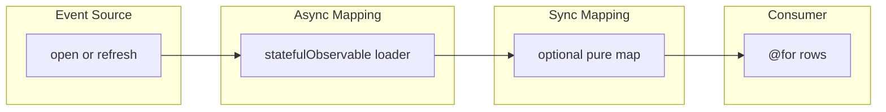

# List

A collection with **no paging**: catalog, “all clients”, `allProducts$()`.
This is [entity-card](entity-card.md) with an **array** consumer (`@for`)
instead of one dump card. The pipeline in [§5.2](../fp_article.md) does not
change.

Paged tables → [list-filters-pagination.md](list-filters-pagination.md).
Windowed fetch → [virtual-scroll.md](virtual-scroll.md). Infinite append is
a different Event Source for **page**, still the pagination scenario.

## Why

A list is not a second kind of state. Mutating `this.items = res` is
[§6.1](../fp_article.md). Initializing the array in `ngOnInit` is
[§6.2](../fp_article.md). The four stages are [§5.2](../fp_article.md).

## Same pipeline

| Stage ([§5.2](../fp_article.md)) | This screen |
| --- | --- |
| Event Source | screen enter, refresh, or parent input |
| Async Mapping | `statefulObservable` `loader`: `getList$()` / `allProducts$()` |
| Sync Mapping | optional `pipeValue` (pure map per item) |
| Consumer | `StatefulBlockComponent` + `@for` |

## Canonical dataflow



## Outdated patterns

- **Mutating subscription** ([§6.1](../fp_article.md)):
  `this.items = res` inside `.subscribe()`.
- **Lifecycle orchestration** ([§6.2](../fp_article.md)): `loadList()` from
  `ngOnInit`.

```typescript
items: Product[] = [];

ngOnInit() {
  this.productsApi.allProducts$().subscribe((products) => {
    this.items = products;
  });
}
```

## Problems

- Refresh / re-enter is another ad-hoc call, not a new Event Source.
- The template and the array can disagree; there is no typed stream.
- Adding filters later means more fields (`page`, `loading`) instead of
  composing Event Sources — see
  [list-filters-pagination.md](list-filters-pagination.md).

## Target

Same mermaid. The list **is** a `statefulObservable` without a parent id
(refresh can be the `input` stream).

```typescript
public readonly itemsStream = statefulObservable({
  loader: () => this.productsApi.allProducts$(),
  cacheKey: () => ['products'],
});
```

Consumer: `<app-stateful-block [stream]="itemsStream">` then
`@for (item of itemsStream.value$ | async)`.

Shared catalog in a service (still `statefulObservable`):
[`products-store.service.ts`](../../src/app/components/wip/stateful-observable/products-store.service.ts).

## In this project

No dedicated list route. Target-shaped illustration: `productsStream` in
[`chaos.component.ts`](../../src/app/components/legacy/chaos/chaos.component.ts)
and `ProductsStoreService.store`. Intermediate: `allProducts$()` inside
[`tiny-store`](../../src/app/components/wip/tiny-store/tiny-store.component.ts)
and [`stream.component.ts`](../../src/app/components/pipe/stream/stream.component.ts).

## Composition

Filters + page on top of this flow →
[list-filters-pagination.md](list-filters-pagination.md). Lazy detail per
row → [list-with-nested-requests.md](list-with-nested-requests.md). Do not
prefetch every nested entity in `getList$`.
