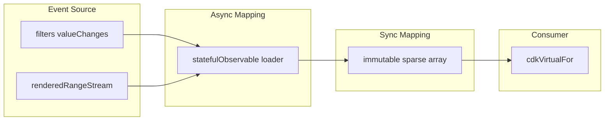

# Virtual scroll

A large **filtered** list where the DOM shows only the visible window.
This is [list-filters-pagination.md](list-filters-pagination.md) with a
different Event Source for “which pages”: the viewport range, not a next
button and not “scrolled to the end”.

It is not infinite scroll. Pages load in both directions and do not have
to accumulate as a prefix. A filter change is a new query and an empty
buffer, not an append.

## Why

The four stages are still [§5.2](../fp_article.md). `ViewChild` as a stream
is [§6.3](../fp_article.md). `scan` / `map` must stay pure
([chapter 4](../fp_article.md)); `splice` on the accumulator is a mutation
that breaks that guarantee.

## Same pipeline

| Stage ([§5.2](../fp_article.md)) | This screen |
| --- | --- |
| Event Source | filter `valueChanges` **and** `renderedRangeStream` (visible indexes) |
| Async Mapping | `statefulObservable` `loader`: `searchClientsPaged$` per visible page; cache key `(filters, page)` |
| Sync Mapping | `pipeValue(scan)` → immutable sparse buffer `(Item \| undefined)[]` |
| Consumer | `*cdkVirtualFor` on `stream.value$` |

## Canonical dataflow



Filters also reset the buffer (new query, not append). Viewport maps
`{ start, end }` to page indexes.

## Outdated patterns

- **Load-all then virtualize**: fetch every row into an array, virtualize
  only the DOM.
- **Mutating sparse buffer** ([§4](../fp_article.md)): `scan` with
  `splice` / `push` on `acc.data`.
- **ViewChild is not a stream** ([§6.3](../fp_article.md)): read the
  viewport from a field in `ngAfterViewInit` instead of
  `ReplaySubject` / `viewChild` → `toObservable`.

```typescript
this.api.allClients$().subscribe((rows) => {
  this.items = rows;
});

scan((acc, page) => {
  acc.data.splice(offset, pageSize, ...page.data);
  return acc;
}, { data: [] })
```

## Problems

- Full dataset in memory; virtualization does not help the network.
- Buffer and filters diverge; old pages stay after a new query.
- `splice` makes `scan` impure; later consumers see shared mutable state.
- Scrolling backward is not an Event Source, so those pages never load.
- Skeletons cannot be “holes in the buffer”; they become extra flags.

## Target

Viewport is an Event Source ([§6.3](../fp_article.md)). Filters join the
same async mapping. Each `scan` step returns a **new** array.

```typescript
protected readonly viewport$ = new ReplaySubject<CdkVirtualScrollViewport>(1);

protected readonly visiblePages$ = this.viewport$.pipe(
  switchMap((v) => v.renderedRangeStream),
  map(({ start, end }) => [Math.floor(start / pageSize), Math.ceil(end / pageSize)]),
  mergeMap(([start, end]) => of(...range(start, end))),
);

public readonly stream = statefulObservable({
  input: combineLatest([this.formValue$, this.visiblePages$]),
  loader: ([filters, page]) =>
    this.clientApiService.searchClientsPaged$({ ...filters, page, pageSize }),
  mapOperator: mergeMap,
  cacheKey: ([filters, page]) => [filters, page],
}).pipeValue(
  scan((acc, curr) => patchSparse(acc, curr), emptyBuffer()),
);
```

`patchSparse` copies `acc.data` (spread or `slice`) then writes the page
slice on the copy. `undefined` slots are the loading UI.

## In this project

[`virtual-scroll.component.ts`](../../src/app/components/xprerimental/virtual-scroll/virtual-scroll.component.ts)
already uses `viewport$` + `renderedRangeStream` + `statefulObservable`.
It is **intermediate**: no filter Event Source, and `scan` mutates with
`splice`. The pattern above is the target (filters like pagination /
infinite-scroll, immutable buffer, cache key `(filters, page)`).

## Composition

Same filter form as
[list-filters-pagination.md](list-filters-pagination.md). Nested detail on
a visible row →
[list-with-nested-requests.md](list-with-nested-requests.md). Do not fall
back to “load the whole list, then CDK”.
