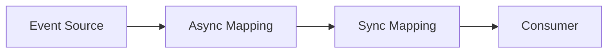
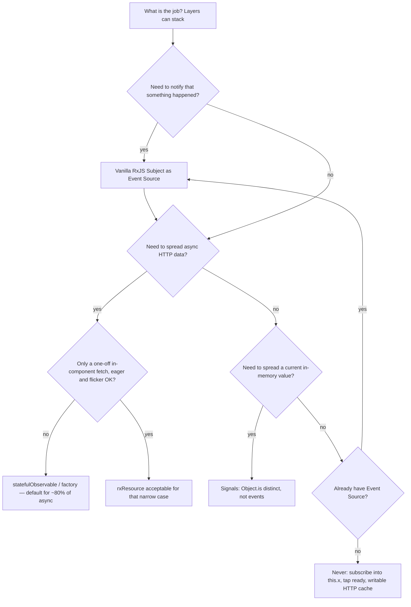

# Signals vs RxJS vs resource vs statefulObservable

These four primitives are not competing architectures. They sit on
**different stages** of the same pipeline. Why that pipeline exists:
[Functional programming in Angular](fp_article.md)
([§4 RxJS vs Signals](fp_article.md), [§5.2](fp_article.md)).
How it looks on screens: [reactive_patterns/](reactive_patterns/README.md).

This file is **which tool owns which stage**. For Async Mapping in a real
Angular app, start with `statefulObservable`: it covers about **80% of
async work** (HTTP, pending/error/reload, combining streams) without the
boilerplate those other primitives push back onto you.



| Primitive | Owns |
| --- | --- |
| **Signals** | **Spread current data**, not events. Prefer `input()` / `viewChild()` over lifecycle hooks. `computed` for a sync view-model. Distinct is `Object.is`: `set(true)` while already `true` does not recompute dependents. Optional signals / queries start `undefined` → extra null checks |
| **Vanilla RxJS** | Event Source as a **notification** (“something happened”), not a data bus. Time operators. Not a loading/error/share primitive |
| **`rxResource` / `resource`** | OK for fetching **in a component**. Eager. Combining loading/error is boilerplate. When the next request starts, `value` is `null` (no stale reads) → UI flicker |
| **`statefulObservable`** | **Default Async Mapping** for ~80% of real-app async: HTTP + loading/error/reload without `tap` subjects, deterministic `pipeValue` / `combineStatefulObservables`. Sentinel on `raw$`; success views keep `T`. Factory for lazy per-id |

Demos (`/signals/signal`, `/wip/resource`, `/pipe/stream`, chaos,
experimental lists) illustrate these roles. They are not a second catalog.

## Same pipeline

| Stage ([§5.2](fp_article.md)) | Typical owner |
| --- | --- |
| Event Source | Vanilla RxJS when something **happened** (must notify even if the payload repeats) |
| Spreading a current value | Signals (`input()`, `viewChild()`, `computed`) — distinct is `Object.is` |
| Async Mapping | **`statefulObservable`** for ~80% of async (HTTP + pending/error/reload + compose). `rxResource` only for a simple in-component fetch |
| Sync Mapping | `pipeValue` / `combineStatefulObservables` / `computed` on already-loaded data |
| Consumer | Dump component signal `input`; `StatefulBlockComponent` for pending/error |

## Signals

Signals **spread data**: they hold the current value and push it to
`computed` / templates / dump `input()`s. They are not an event bus.

Prefer `input()` / `input.required()` and `viewChild()` /
`viewChildren()` instead of `@Input` + `ngOnChanges` or `@ViewChild` +
`ngAfterViewInit` ([§6.2](fp_article.md), [§6.3](fp_article.md)). That
removes lifecycle hooks. It does **not** turn the signal into Event
Source in the [§5.2](fp_article.md) sense. `viewChild()` is still
`undefined` until the view exists: no hook, but the value hole remains.

**Internal distinct works against event sourcing.** Default equality is
`Object.is`, not deep equal. A primitive `true` written twice is a
no-op. A new object with the same fields **will** notify.

```typescript
const ok = signal(true);
effect(() => console.log(ok()));
ok.set(true); // no recompute, no effect
ok.set(true); // still nothing
```

Dependent `computed`s do not rerun. `effect`s do not run. `toObservable`
does not emit. If the job is “true happened again” (save clicked twice),
use vanilla RxJS (`Subject`), not a signal.

Other strengths ([§4](fp_article.md)): synchronous reads, fine-grained
change detection, a clean Consumer for data that is **already loaded**.

**Flaw:** reads are synchronous. An optional `input()` or `viewChild()`
starts as `undefined` until the real value exists, so `computed` and
templates need null checks a cold observable would not force until the
first emit. `input.required()` does **not** invent a dummy: reading it
before the first binding throws.

The signal primitive has no `switchMap` / cancel. For async, bridge with
`toObservable` into `statefulObservable` (see Interop). Writable
`signal()` / `linkedSignal()` reintroduce mutation ([§4](fp_article.md)).

**Use for**

- Spreading a current value: `input()` / `viewChild()` / `computed()`
- Dump children that read loaded data

**Do not use for** events, HTTP cache, loading flags, or “notify even if
equal”. Bridge a changing **value** with `toObservable` into
`statefulObservable` when you need a stream of **distinct** ids, not a
stream of clicks.

Dump Consumer:
[`client-info.component.ts`](../src/app/components/content/client-info/client-info.component.ts)
(`displayData = input()`). Anti-pattern: writable ready flags next to Rx
fetch in
[`signal.component.ts`](../src/app/components/signals/signal/signal.component.ts).

## Misconception: signals as replacements to RxJS

A common slogan is: *signals shipped, so RxJS is obsolete.* That is not
what the Angular team proposed.

Signals were added as the framework **reactivity primitive**: tell
change detection **what** changed, give templates a **synchronous
current value**, open a path off `zone.js`. They were **not** a plan to
move every stream, HTTP call, and click onto `signal()`.

The Signals RFC lists **smooth interoperability with RxJS** as a goal
([main RFC](https://github.com/angular/angular/discussions/49685)).
Interop has its own write-up
([Sub-RFC 4](https://github.com/angular/angular/discussions/49681)).

[Sub-RFC 1](https://github.com/angular/angular/discussions/49684)
considered Observable as the CD primitive and **rejected it for
templates**: a binding must always have a current value; Observables
need not emit on subscribe; a cold `HttpClient` subscribe is a side
effect (two `| async` can mean two requests); RxJS is not glitch-free
for sync UI. The same text says RxJS **shines at orchestrating async**
(debounce, retry, complex flows). The conclusion is interop, not
replacement.

Angular APIs in that RFC split the same way: a **value over time**
(form status, router params) may become a signal; a **stream of
events** must not. `HttpClient` and `EventEmitter` are named as APIs
that **should not** be expressed as signals.

The slogan collapses two substitutions. Signals target **Zone.js and
model → UI sync**. RxJS stays the tool for events and async
orchestration. This file’s pipeline is that split: Subject as Event
Source, `statefulObservable` as Async Mapping, signal `input()` as
Consumer of **already loaded** data.

## Vanilla RxJS

Primary goal is **notifying that something happened**, not distributing a
payload. Clicks, “save clicked”, filter `valueChanges` as events, viewport
`renderedRangeStream`. Emit the fact; hand it to a loader.

Unlike a signal, a `Subject` does **not** distinct. Two `save$.next()`
calls are two notifications even if nothing in memory changed. That is
why events do not live in signals.

**Use for** Event Source, then hand the fact to a loader — do not stop at
the Subject if data must be fetched:

```typescript
public readonly save$ = new Subject<void>();
```

`toObservable(this.clientId)` is not an event source: it follows the
signal’s distinct current value (id **changed**), then feeds a loader.

Do **not** use vanilla pipes as the data store. Loading and error become
boilerplate (`tap` + `BehaviorSubject`). `shareReplay` only prevents
duplicate HTTP when **several** subscribers would resubscribe a cold
source. That pair is reinventing `statefulObservable`.

Anti-pattern:
[`stream.component.ts`](../src/app/components/pipe/stream/stream.component.ts)
— `tap` flips loading subjects, `shareReplay(1)` on `populatedBucket$`.

## `rxResource` / `resource`

OK for fetching data **inside a component** when the request params are a
current signal value (not an event stream). Demo:
[`resource.component.ts`](../src/app/components/wip/resource/resource.component.ts).

Flaws:

- **No lazy loading.** Resources are signal-based, so they are eager
  ([§4](fp_article.md) — signals have no defer-until-subscribe).
- **Compose is boilerplate.** N resources means hand-merging `isLoading()`,
  `error()`, and `value()`. See
  [`combineResources.ts`](../src/app/services/resource/combineResources.ts).
- **The next request pushes `null` to `value`.** That is a design choice,
  not an accident. See below.

**Use** for a simple in-component fetch when eager load and refetch flicker
are acceptable.

**Do not use** for nested row factory, virtual-scroll `mergeMap` of pages,
form-created-in-stream, current subscribers that must keep the last
value without a null wipe, or combining many handles without extra glue.
Those screens: [reactive_patterns](reactive_patterns/README.md) →
`statefulObservable`.

### Most people are not aware: a new request pushes `null` to `value`

When the next request starts, Resource pushes `null` into `value()`.
Tables and cards go blank. That looks like a bug. It is the design.
People expect the old rows to stay until the new payload arrives. They
do not.

Data is already in `value`. A **next** request has started. The response
is not back yet. What must a synchronous `value()` contain?

Angular had two options:

1. **Keep the old value.** Anyone who reads `value` during the in-flight
   request gets data that is **guaranteed stale**, with no hole in the
   type to notice.
2. **Push `null`.** Nobody reads stale data. The consumer sees `null` →
   `@if (resource.value())` tears down the card → **UI flicker**.

A synchronous `value()` cannot mean both “here is the entity” and “a
newer load is in flight”. For that in-flight request Resource picks
**(2)**: `null` in `value` so stale is not mistaken for current. Flicker
is the side effect of that honesty, not a leftover to wait out.

`statefulObservable` also has one shared slot: multicast `raw$`
(`shareReplay({ bufferSize: 1 })`). The slot is a **union**, not a data
field. A next request **pushes a loading sentinel** `{ state: loading }`
into `raw$`. `pending$` is only `map(isLoading)` — a boolean, not the
sentinel. `value$` and the stream’s `subscribe` / `async` are
`filter(isSuccess)`: loading is not a `next`.

- A **current** success subscriber gets no emission, so the last `T`
  stays on screen. Nothing writes `null` over that view.
- A **new** success subscriber: if `shareReplay` replays loading, the
  filter drops it and they **wait**. They do not get the old entity as
  current. If replay is still success, they get that `T` immediately.

Resource cannot do this: a synchronous `value()` has no third state, so
it must pick stale `T` or `null`. The union + filter pattern solves
both. LLMs mostly do not know that shape exists. They treat
`statefulObservable` as Resource (`null` in data), as vanilla
`shareReplay` + `tap` loading flags, or they invent rules such as
“sentinel lives on `pending$`” / “`value$` holds the payload for
everyone”. Read `raw$` / `value$` / `pending$` from the package, not
from that guess.

## `statefulObservable`

**Use this for spreading async data.** In a typical Angular app that is
most of the I/O: entity cards, lists, nested row fetches, save-then-reload,
cache, lazy accordion. Built-in `pending$` / `error$` / `reload` replace
`tap` + `BehaviorSubject` loading machines. `pipeValue` and
`combineStatefulObservables` compose payloads as a **deterministic**
pipeline (Event Source → loader → pure map → Consumer) instead of
hand-merging N loading flags. That is about **80% of async ops**; the rest
is events (`Subject`) and spreading an already-loaded value (signals).

Not a sync current value (signals) and not a click bus (vanilla RxJS).
New request → loading sentinel on `raw$`; success subscribers are not
wiped. Lazy `statefulObservableFactory` per id.

**Use for** HTTP screens in [reactive_patterns](reactive_patterns/README.md):
[entity-card](reactive_patterns/entity-card.md),
[complex-entity-card](reactive_patterns/complex-entity-card.md)
(`combineStatefulObservables`),
[entity-edit](reactive_patterns/entity-edit.md),
[list](reactive_patterns/list.md),
[list-filters-pagination](reactive_patterns/list-filters-pagination.md),
[list-with-nested-requests](reactive_patterns/list-with-nested-requests.md)
(factory),
[virtual-scroll](reactive_patterns/virtual-scroll.md) (`pipeValue(scan)`).

Consumer: `StatefulBlockComponent` + dump signal inputs.

## When to use which



| You are about to… | Pick |
| --- | --- |
| Spread a current in-memory value; replace `@Input` / `@ViewChild` lifecycle | `input()` / `viewChild()` / `computed` — distinct is `Object.is`; optional values start `undefined` |
| Notify that something happened (click, submit; must fire even if payload repeats) | Vanilla RxJS `Subject` as Event Source, then feed a loader if data is needed |
| HTTP / spread async data (pending, error, reload, cache, compose, lazy nested ids) | **`statefulObservable` / factory** — default for ~80% of async ops |
| One-off fetch in one component; eager OK; flicker on refetch OK | `rxResource` is acceptable for that narrow case |
| Store HTTP in a writable signal; vanilla RxJS as the loading machine; `.subscribe()` into `this.x`; `tap` to flip `ready` | Never ([§6.1](fp_article.md), [§4](fp_article.md)) |

## Interop

Typical wiring:

```text
input()  →  toObservable  →  statefulObservable.loader
                              →  value$ / pending$ / error$
                              →  StatefulBlock  →  dump [data]="client" (signal input)
```

`input()` holds the current id (signal, distinct). `toObservable` emits
only when that id **changes**. `save$` is the Event Source because a
repeated click is a new fact. Dump children take the loaded **value** as
`input()`.

`rxResource` is a narrow exception: one eager in-component fetch where
flicker is acceptable. For the rest of async mapping — loading/error/reload
without boilerplate, and composing several streams deterministically —
use `statefulObservable`.
